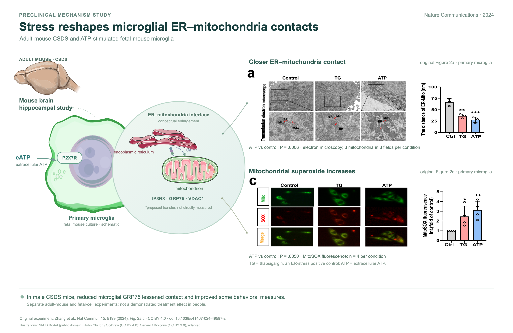
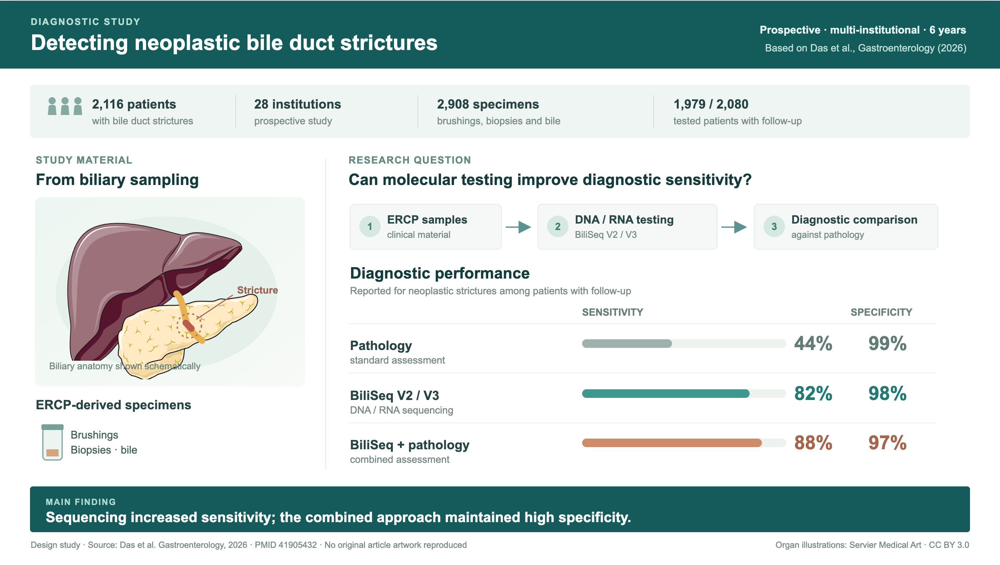

# Ye1 论文图形摘要

**让论文的研究故事、原始图表与医学插画融为一张图形摘要。**

面向医学与科研论文作者，支持 Skill 指引的各类 AI Agent。把论文和独立原始图件交给 Agent，就可以用自然语言开始。

## 能做什么

- 阅读论文与图注，梳理研究设计、主要发现和关键图表的对应关系。
- 根据文章内容构思画面，选择真正有助于表达的人物、器官、细胞、场景或研究流程；不直接套用固定模板。
- 从作者提供的独立原始图件中选择合适的图或面板，与插画、标签和研究逻辑统一构图，保留原图的科学含义。
- 制作可离线打开、可修改版式的 HTML 图形摘要；按当前工具能力，可进一步导出图片或 PDF。
- 核对研究数据、原图、素材许可和重要限制，并保留场景提示词与来源说明。

默认使用 HTML、CSS 和 SVG 排版，不使用 AI 图像生成模型。可使用自绘示意或授权医学插画；论文中的实验图像与示意图会分别标明。

## 看看效果

### 基础研究：小胶质细胞与细胞器接触

依据公开论文制作，将原文电镜、荧光图及量化结果与小鼠脑、细胞和细胞器示意融合；区分小鼠实验和原代细胞实验。论文和素材来源附在样张页面中。

### 临床诊断：胆道研究

以胆道解剖为视觉主体，组织研究设计与主要诊断结果。该早期样张的结果区依据公开论文数据重新绘制，供视觉参考。

完整 Skill 文件夹内还包含更多医学插图方向的 HTML 样张，可下载后用浏览器打开。这些样张展示设计思路，不作为新论文的固定模板。

## 安装到你的 Agent

将下面这段话发给你的 Agent：

> 请从 https://github.com/Nzjye1/ye1-graphical-abstract 获取 Ye1 论文图形摘要。读取 `skills/ye1-graphical-abstract/SKILL.md`，按当前 Agent 支持的方式安装完整 Skill 文件夹，并告诉我如何开始使用。

也可以下载 [通用 Skill 包](downloads/ye1-graphical-abstract-skill.zip)，解压后把完整的 `ye1-graphical-abstract` 文件夹交给 Agent，或按当前软件提示导入。

制作和检查图形摘要需要当前 Agent 能读取论文及图件，并使用可用工具生成、预览 HTML；图片或 PDF 导出取决于所在环境支持的工具。

## 开始使用

提供论文、相应图注和独立原始图表，然后告诉 Agent：

> 请根据这篇论文和我提供的原始图表，制作一张图形摘要。先理解研究主线，选择最能支持结果的图表，再根据文章内容搭配合适的人物、器官或场景，统一构图并生成可编辑 HTML。请核对数据、图表和素材来源。

也可以指定期刊要求、输出尺寸、语言和喜欢的视觉风格。没有合适插画时，也可以用图表与研究流程清楚表达。

## 使用前需要知道

- 客户资料请按适用要求在本地脱敏；图件中的文字和元数据也需要检查。
- 投稿或公开使用前，作者需核对图表、素材的使用许可与目标期刊要求。
- 原图如果是位图，HTML 排版可以修改，位图里的曲线和文字不一定能单独编辑。

## 联系与许可

微信：**ye1aikeyan** · 邮箱：[ye1aikeyan@163.com](mailto:ye1aikeyan@163.com)

本仓库中 Ye1 拥有授权权利的内容采用 [CC BY-NC 4.0](LICENSE)；样张中的论文图与第三方插画保留各自的许可、署名和修改说明，详见 [第三方素材说明](THIRD-PARTY-NOTICES.md) 与各样张页面。

本版许可范围与历史 MIT 授权见 [许可与历史声明](LICENSING.md)。
